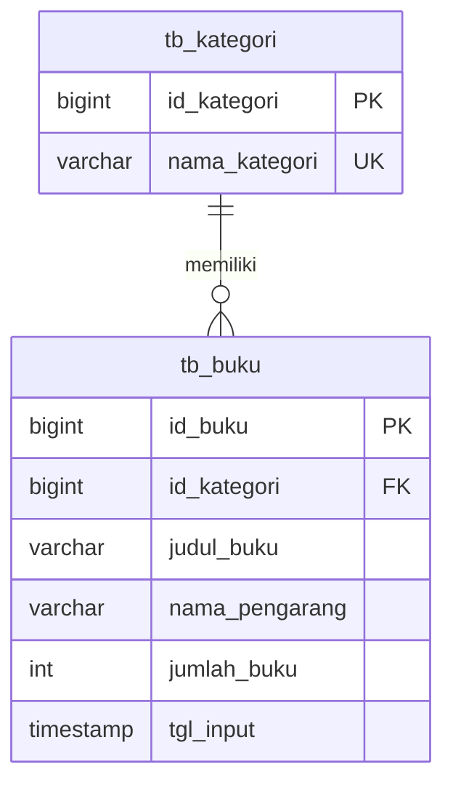

# 📚 Perpustakaan API

**Layanan REST untuk pengelolaan kategori dan data buku perpustakaan.**


Proyek ini merupakan implementasi web service untuk tugas Ujian Tengah Semester (UTS), dengan mengadaptasi pengelolaan **kategori** dan **buku** dari sebuah penelitian sistem informasi perpustakaan. Aplikasi menyediakan operasi *Create, Read, Update, Delete* (CRUD), validasi masukan, relasi basis data, serta pengujian otomatis.

| Komponen | Ringkasan |
| --- | --- |
| Ruang lingkup | Pengelolaan kategori dan buku |
| Framework | Laravel 13.42.0, dikunci melalui `composer.lock` |
| Entitas utama | `tb_kategori` dan `tb_buku` |
| Relasi | Satu kategori dapat memiliki banyak buku |
| Antarmuka | REST API dengan respons JSON |
| Pengujian | PHPUnit dan Postman Collection |

> **Status implementasi:** CRUD kategori dan buku telah tersedia. API ditujukan untuk lingkungan lokal UTS dan belum menggunakan autentikasi.

---

## Daftar Isi

- [Gambaran Umum](#gambaran-umum)
- [Fitur](#fitur)
- [Teknologi dan Persyaratan](#teknologi-dan-persyaratan)
- [Instalasi Lokal](#instalasi-lokal)
- [Struktur Proyek](#struktur-proyek)
- [Desain Basis Data](#desain-basis-data)
- [Dokumentasi API](#dokumentasi-api)
- [Aturan Validasi](#aturan-validasi)
- [Pengujian dengan Postman](#pengujian-dengan-postman)
- [Pengujian Otomatis](#pengujian-otomatis)
- [Perintah Pengembangan](#perintah-pengembangan)
- [Pemecahan Masalah](#pemecahan-masalah)
- [Batasan Implementasi](#batasan-implementasi)
- [Referensi dan Dokumentasi Lanjutan](#referensi-dan-dokumentasi-lanjutan)

## Gambaran Umum

Aplikasi memisahkan data kategori dari data buku agar informasi kategori tidak perlu disimpan berulang pada setiap buku. Setiap buku memiliki satu referensi kategori melalui `id_kategori`. Integritas hubungan tersebut dijaga oleh validasi aplikasi dan *foreign key* pada basis data.

### Dasar penelitian

**Siregar, Guna Yanti Kemala Sari, dan Dani Anggoro. (2021).** *Perancangan Aplikasi Pengolahan Data Buku pada Perpustakaan SMA Negeri 1 Batanghari Lampung Timur.* JIKI, Volume 2, Nomor 1.

[Halaman artikel](https://scholar.ummetro.ac.id/index.php/jiki/article/view/1111) · [DOI: 10.24127/jiki.v2i1.1111](https://doi.org/10.24127/jiki.v2i1.1111)

Penelitian tersebut menggunakan Borland Delphi 7 dan MySQL, serta mencakup tabel buku, kategori, tambahstok, dan petugas. Proyek ini mengimplementasikan sebagian ruang lingkupnya menggunakan Laravel REST API, dengan mengambil entitas kategori dan buku.

Nama tabel implementasi, tipe data, panjang kolom, batas validasi, ID otomatis, dan kebijakan penghapusan merupakan **keputusan adaptasi teknis**. Proyek ini tidak dimaksudkan sebagai reproduksi lengkap aplikasi dalam penelitian.

## Fitur

| Fitur | Perilaku yang tersedia |
| --- | --- |
| CRUD kategori | Menambah, menampilkan, memperbarui, dan menghapus kategori |
| CRUD buku | Menambah, menampilkan, memperbarui, dan menghapus data buku |
| Informasi relasi | Respons buku menyertakan kategori; detail kategori menyertakan buku |
| Ringkasan kategori | Daftar kategori menyertakan `buku_count` |
| Validasi masukan | Memeriksa kolom wajib, keunikan, FK, panjang teks, tahun, tanggal, dan stok |
| Perlindungan relasi | Kategori yang masih digunakan buku tidak dapat dihapus |
| Pembaruan parsial | Mendukung `PATCH` untuk mengubah kolom tertentu |
| Pencatatan waktu | `tgl_input` diisi otomatis ketika data buku dibuat |
| Data contoh | Seeder menyediakan dua kategori dan satu buku |
| Pengujian | Tes aplikasi, basis data, API, dan collection Postman |

## Teknologi dan Persyaratan

| Kebutuhan | Keterangan |
| --- | --- |
| PHP | Sesuai constraint `^8.3` pada `composer.json` |
| Composer | Composer 2 yang kompatibel dengan versi PHP yang digunakan |
| Basis data | MySQL atau MariaDB |
| Lingkungan lokal | Laragon direkomendasikan untuk panduan Windows ini |
| Klien HTTP | Postman atau klien HTTP lain |
| SQLite | Driver `pdo_sqlite` untuk menjalankan suite tes bawaan |

Ekstensi PHP yang perlu tersedia meliputi `ctype`, `curl`, `dom`, `fileinfo`, `filter`, `hash`, `mbstring`, `openssl`, `pcre`, `pdo`, `session`, `tokenizer`, `xml`, serta `pdo_mysql` untuk koneksi basis data utama.

Node.js dan npm tidak diperlukan untuk menjalankan aplikasi ini. Newman merupakan pilihan tambahan apabila pengujian collection ingin dijalankan melalui terminal.

## Instalasi Lokal

Panduan berikut menggunakan Terminal Laragon pada Windows. Sesuaikan direktori dan konfigurasi basis data dengan lingkungan yang digunakan.

> **Untuk proyek Tahap 2 yang sudah terpasang:** gunakan [panduan pembaruan Tahap 3](docs/UPGRADE_TAHAP3.md). Pertahankan `.env` dan basis data yang sudah digunakan; tidak diperlukan pembuatan ulang tabel.

### 1. Siapkan direktori proyek

Ekstrak proyek sehingga file `artisan` dan `composer.json` berada di dalam direktori berikut:

```text
C:\laragon\www\uts-perpustakaan
```

Buka direktori tersebut melalui Terminal Laragon:

```bat
cd C:\laragon\www\uts-perpustakaan
php -v
composer --version
```

Apabila Composer lama menampilkan peringatan kompatibilitas dengan PHP, perbarui terlebih dahulu:

```bat
composer self-update --2
```

Installer alternatif tersedia pada [situs resmi Composer](https://getcomposer.org/download/).

### 2. Pasang dependensi

```bat
composer install
php artisan --version
```

Gunakan `composer install` agar versi dependensi mengikuti `composer.lock`. Versi framework yang digunakan paket ini adalah `Laravel Framework 13.42.0`.

### 3. Siapkan konfigurasi aplikasi

Untuk instalasi baru yang belum memiliki `.env`, jalankan:

```bat
copy .env.example .env
php artisan key:generate
```

File `.env` menyimpan konfigurasi lokal dan tidak disertakan dalam pengumpulan kode. Jangan menimpa file tersebut apabila konfigurasi aplikasi sudah dibuat sebelumnya.

### 4. Buat basis data

Jalankan layanan MySQL/MariaDB pada Laragon, kemudian buka HeidiSQL, phpMyAdmin, atau klien SQL yang tersedia.

Nama basis data mengikuti format **`MOBILE_<NPM>`**. Angka `12345678` berikut merupakan contoh dan harus diganti dengan NPM mahasiswa:

```sql
CREATE DATABASE MOBILE_12345678
    CHARACTER SET utf8mb4
    COLLATE utf8mb4_unicode_ci;
```

Sesuaikan `.env` dengan basis data yang telah dibuat:

```dotenv
APP_NAME="UTS Perpustakaan"
APP_ENV=local
APP_DEBUG=true
APP_URL=http://127.0.0.1:8000

DB_CONNECTION=mysql
DB_HOST=127.0.0.1
DB_PORT=3306
DB_DATABASE=MOBILE_12345678
DB_USERNAME=root
DB_PASSWORD=

SESSION_DRIVER=file
CACHE_STORE=file
QUEUE_CONNECTION=sync
```

Gunakan nama pengguna, kata sandi, dan port yang sesuai. `DB_PASSWORD` hanya dibiarkan kosong apabila akun basis data lokal memang tidak memiliki kata sandi. Konfigurasi session dan cache berbasis file membuat aplikasi tidak memerlukan tabel session atau cache tambahan.

### 5. Jalankan migration dan seeder

```bat
php artisan config:clear
php artisan migrate --seed
php artisan migrate:status
```

Hasil yang diharapkan:

- Kedua migration berstatus `Ran`.
- Tabel `tb_kategori` dan `tb_buku` berhasil dibuat.
- Tabel internal `migrations` tersedia untuk pencatatan migration Laravel.
- Seeder menghasilkan kategori **Teknologi**, kategori **Fiksi**, dan buku **Dasar-Dasar Komputer** dengan jumlah awal **5**.

Data seeder merupakan contoh pengujian, bukan data yang diambil dari penelitian. Seeder menggunakan `firstOrCreate`; data dengan kriteria pencarian yang sama tidak dibuat ulang dan stok yang sudah diperbarui tidak direset. Apabila nama kategori atau identitas pencarian buku diubah, seeder dapat membuat kembali contoh semula.

> **Perhatian:** `php artisan migrate:fresh` menghapus seluruh tabel pada koneksi yang digunakan. Perintah tersebut tidak diperlukan dalam instalasi atau pembaruan normal proyek ini.

### 6. Jalankan server

```bat
php artisan route:list --path=api
php artisan serve
```

| Alamat | Fungsi |
| --- | --- |
| `http://127.0.0.1:8000/` | Informasi aplikasi dalam JSON |
| `http://127.0.0.1:8000/up` | Pemeriksaan kesehatan aplikasi |
| `http://127.0.0.1:8000/api/kategori` | Daftar kategori |
| `http://127.0.0.1:8000/api/buku` | Daftar buku |

Pendaftaran route menampilkan **10 baris resource route**; `PUT` dan `PATCH` berbagi baris update pada masing-masing resource. Respons berhasil dari `/` atau `/up` saja belum membuktikan koneksi basis data. Gunakan endpoint kategori atau buku untuk memeriksa akses data.

## Struktur Proyek

| Lokasi | Tanggung jawab |
| --- | --- |
| [`routes/api.php`](routes/api.php) | Pendaftaran route kategori dan buku |
| [`bootstrap/app.php`](bootstrap/app.php) | Aktivasi routing API dan penanganan respons kesalahan |
| [`app/Http/Controllers/Api/KategoriController.php`](app/Http/Controllers/Api/KategoriController.php) | Operasi CRUD kategori dan penanganan konflik penghapusan |
| [`app/Http/Controllers/Api/BukuController.php`](app/Http/Controllers/Api/BukuController.php) | Operasi CRUD buku dan pemuatan relasi kategori |
| [`app/Http/Requests/KategoriRequest.php`](app/Http/Requests/KategoriRequest.php) | Validasi masukan kategori |
| [`app/Http/Requests/BukuRequest.php`](app/Http/Requests/BukuRequest.php) | Validasi masukan buku |
| [`app/Models/Kategori.php`](app/Models/Kategori.php) | Model kategori dan relasi `hasMany` |
| [`app/Models/Buku.php`](app/Models/Buku.php) | Model buku, casting, dan relasi `belongsTo` |
| [`database/migrations`](database/migrations) | Definisi tabel dan constraint |
| [`database/seeders/DatabaseSeeder.php`](database/seeders/DatabaseSeeder.php) | Data contoh |
| [`tests/Feature`](tests/Feature) | Tes aplikasi, basis data, dan API |
| [`postman`](postman) | Collection pengujian HTTP |
| [`docs`](docs) | Dokumentasi teknis tambahan |

Request diterima oleh route, kemudian ID diikat ke model melalui *route model binding*. Operasi penyimpanan dan pembaruan melewati Form Request untuk validasi. Controller meneruskan data yang tervalidasi ke Eloquent, lalu mengembalikan respons JSON kepada klien.

## Desain Basis Data

### Relasi entitas



Diagram menampilkan kolom inti. Struktur lengkap dijelaskan pada tabel berikut.

### Tabel kategori

| Kolom | Tipe data | Ketentuan |
| --- | --- | --- |
| `id_kategori` | BIGINT UNSIGNED | Primary key, auto increment |
| `nama_kategori` | VARCHAR(100) | Wajib diisi, unik |

### Tabel buku

| Kolom | Tipe data | Ketentuan |
| --- | --- | --- |
| `id_buku` | BIGINT UNSIGNED | Primary key, auto increment |
| `id_kategori` | BIGINT UNSIGNED | Foreign key, tidak boleh null |
| `judul_buku` | VARCHAR(255) | Tidak boleh null; judul yang sama diperbolehkan |
| `nama_pengarang` | VARCHAR(150) | Tidak boleh null |
| `penerbit` | VARCHAR(150) | Nullable |
| `tahun_terbit` | SMALLINT UNSIGNED | Nullable |
| `cetakan` | VARCHAR(50) | Nullable |
| `tempat_terbit` | VARCHAR(100) | Nullable |
| `tgl_terima` | DATE | Nullable |
| `asal_buku` | VARCHAR(100) | Nullable |
| `jumlah_buku` | INT UNSIGNED | Tidak boleh null; nilai awal 0 |
| `keterangan` | TEXT | Nullable |
| `tgl_input` | TIMESTAMP | Nilai awal waktu pembuatan data |

Kebijakan integritas data:

- Setiap buku wajib merujuk satu kategori yang tersedia.
- Satu kategori dapat memiliki nol atau banyak buku.
- Foreign key menggunakan kebijakan `RESTRICT` untuk penghapusan dan pembaruan ID kategori.
- Penghapusan buku tidak menghapus kategorinya.
- Kedua model menggunakan `$timestamps = false`; tidak terdapat `created_at` dan `updated_at`.
- `tgl_input` tidak berubah otomatis ketika data buku diperbarui.

## Dokumentasi API

### Alamat dasar dan header

```text
http://127.0.0.1:8000/api
```

```http
Accept: application/json
Content-Type: application/json
```

Header `Content-Type` digunakan ketika mengirim body JSON. Prefix `/api` ditambahkan oleh konfigurasi Laravel; jangan menuliskannya dua kali dalam URL.

### Daftar endpoint

| Metode | Endpoint | Fungsi | Status berhasil |
| --- | --- | --- | --- |
| GET | `/kategori` | Menampilkan seluruh kategori | 200 |
| GET | `/kategori/{id_kategori}` | Menampilkan kategori beserta bukunya | 200 |
| POST | `/kategori` | Membuat kategori | 201 |
| PUT / PATCH | `/kategori/{id_kategori}` | Memperbarui kategori | 200 |
| DELETE | `/kategori/{id_kategori}` | Menghapus kategori yang tidak digunakan | 200 |
| GET | `/buku` | Menampilkan seluruh buku beserta kategorinya | 200 |
| GET | `/buku/{id_buku}` | Menampilkan detail buku | 200 |
| POST | `/buku` | Membuat buku | 201 |
| PUT / PATCH | `/buku/{id_buku}` | Memperbarui buku | 200 |
| DELETE | `/buku/{id_buku}` | Menghapus buku | 200 |

Ganti parameter ID dengan nilai yang diperoleh dari respons API. Nilai `1` pada contoh berikut bersifat ilustratif dan tidak dijamin tersedia pada setiap basis data.

### Membuat kategori

**Request — `POST /api/kategori`**

```json
{
  "nama_kategori": "Referensi"
}
```

**Contoh respons — `201 Created`**

```json
{
  "message": "Kategori berhasil ditambahkan.",
  "data": {
    "nama_kategori": "Referensi",
    "id_kategori": 1
  }
}
```

### Membuat buku

**Request — `POST /api/buku`**

```json
{
  "id_kategori": 1,
  "judul_buku": "Pengantar Basis Data",
  "nama_pengarang": "Penulis Contoh",
  "penerbit": "Pustaka Akademik",
  "tahun_terbit": 2022,
  "cetakan": "Pertama",
  "tempat_terbit": "Banjarmasin",
  "tgl_terima": "2026-11-11",
  "asal_buku": "Pembelian",
  "jumlah_buku": 5,
  "keterangan": "Data contoh untuk pengujian API."
}
```

Respons berhasil menggunakan status `201`, dengan objek buku pada `data` dan objek kategori terkait pada `data.kategori`. `id_buku` dan `tgl_input` dihasilkan oleh sistem.

### Memperbarui sebagian data

**Request — `PATCH /api/buku/1`**

```json
{
  "jumlah_buku": 8,
  "keterangan": "Jumlah buku telah diperbarui."
}
```

Kolom yang tidak dikirim tetap mempertahankan nilainya. Untuk mengosongkan kolom nullable, kirim nilai `null` pada kolom tersebut.

**Perbedaan PUT dan PATCH dalam implementasi ini:**

| Operasi | Kolom utama yang wajib dikirim |
| --- | --- |
| POST atau PUT kategori | `nama_kategori` |
| POST atau PUT buku | `id_kategori`, `judul_buku`, `nama_pengarang` |
| PATCH | Hanya kolom yang ingin diubah; kolom wajib yang dikirim tetap tidak boleh kosong |

Pada PUT, kolom opsional yang tidak dikirim juga dipertahankan. Dengan demikian, PUT pada proyek ini tidak mereset seluruh kolom opsional yang dihilangkan dari body.

### Format respons dan kesalahan

| Kondisi | HTTP | Struktur utama |
| --- | --- | --- |
| Daftar data | 200 | `message` dan `data` berupa array |
| Detail atau pembaruan | 200 | `message` dan `data` berupa objek |
| Pembuatan data | 201 | `message` dan `data` berupa objek |
| Penghapusan berhasil | 200 | `message` |
| Data atau endpoint tidak ditemukan | 404 | `message` |
| Kategori masih digunakan buku | 409 | `message` |
| Masukan tidak valid | 422 | `message` dan `errors` per kolom |

Contoh respons ketika kategori masih digunakan:

```json
{
  "message": "Kategori masih digunakan oleh buku dan tidak dapat dihapus."
}
```

Contoh respons ketika ID tidak ditemukan:

```json
{
  "message": "Data atau endpoint tidak ditemukan."
}
```

Daftar data diurutkan berdasarkan primary key dan belum menggunakan pagination. Daftar kosong tetap dikembalikan sebagai `data: []`, bukan `404`.

## Aturan Validasi

| Kolom | Ketentuan aplikasi |
| --- | --- |
| `nama_kategori` | String tidak kosong, maksimal 100 karakter, unik; update dapat mempertahankan nama sendiri |
| `id_kategori` pada buku | Integer positif dan tersedia di `tb_kategori` |
| `judul_buku` | String tidak kosong, maksimal 255 karakter |
| `nama_pengarang` | String tidak kosong, maksimal 150 karakter |
| `penerbit` | Nullable, string maksimal 150 karakter |
| `tahun_terbit` | Nullable, integer empat digit, dari 1000 sampai tahun berjalan + 1 |
| `cetakan` | Nullable, string maksimal 50 karakter |
| `tempat_terbit` | Nullable, string maksimal 100 karakter |
| `tgl_terima` | Nullable, tanggal valid berformat `YYYY-MM-DD` |
| `asal_buku` | Nullable, string maksimal 100 karakter |
| `jumlah_buku` | Integer dari 0 sampai 4294967295; null tidak diterima |
| `keterangan` | Nullable, string maksimal 10000 karakter |

Middleware Laravel memangkas whitespace di awal dan akhir string serta mengubah string kosong menjadi null. Controller hanya meneruskan hasil `validated()` ke model; kolom yang tidak dikenal tidak disimpan.

Primary key dan `tgl_input` tidak boleh ditentukan sendiri melalui masukan non-kosong. Apabila `jumlah_buku` tidak dikirim saat pembuatan buku, basis data menggunakan nilai awal 0.

Batas tahun dan panjang keterangan merupakan kebijakan implementasi aplikasi, bukan spesifikasi literal penelitian rujukan.

## Pengujian dengan Postman

Collection tersedia pada:

[`postman/UTS_Perpustakaan_Laravel13_Tahap3.postman_collection.json`](postman/UTS_Perpustakaan_Laravel13_Tahap3.postman_collection.json)

### Menjalankan collection

1. Pastikan server Laravel dan layanan basis data berjalan.
2. Pilih **Import** pada Postman, kemudian masukkan file collection.
3. Pilih **No environment** agar variabel lingkungan lain tidak menimpa konfigurasi collection.
4. Periksa variabel pada collection sebagaimana tabel berikut.
5. Jalankan seluruh collection secara berurutan menggunakan **1 iteration**.
6. Periksa status respons dan hasil assertion pada setiap request.

| Variabel | Nilai atau fungsi |
| --- | --- |
| `base_url` | `http://127.0.0.1:8000`, tanpa `/api` dan tanpa garis miring di akhir |
| `enable_crud` | `true` untuk mengaktifkan alur CRUD |
| `id_kategori` | Diisi otomatis dari hasil pembuatan kategori |
| `id_buku` | Diisi otomatis dari hasil pembuatan buku |
| `run_tag` | Penanda unik untuk nama data uji |

Collection mencakup **20 request**: dua pemeriksaan aplikasi dan 18 request CRUD, validasi, konflik relasi, serta pembersihan data uji. Alurnya membuat kategori, membuat buku, menguji perubahan dan penolakan masukan, kemudian menghapus buku dan kategori uji.

Jangan mengganti ID collection dengan ID data penting. Jika pengujian dihentikan sebelum langkah pembersihan, data uji dapat tertinggal. Request yang dilewati akibat `enable_crud=false` bukan pengujian yang berhasil.

Collection lama dari Tahap 2 tetap dapat digunakan setelah `enable_crud` diubah menjadi `true`, tetapi nama folder dan deskripsinya masih menyebut rancangan. Gunakan collection Tahap 3 untuk dokumentasi yang sesuai.

## Pengujian Otomatis

Jalankan suite pengujian melalui terminal proyek:

```bat
php artisan test
```

Konfigurasi `phpunit.xml` memaksa penggunaan **SQLite in-memory** untuk pengujian bawaan, sehingga pengujian tersebut tidak memakai basis data MySQL utama pada `.env`. Driver `pdo_sqlite` harus aktif.

### Hasil verifikasi yang tercatat

Verifikasi paket dilaksanakan pada **11 November 2026**, menggunakan Linux, PHP 8.4.27, Laravel 13.42.0, PHPUnit 12.5.43, dan MariaDB 11.8.6.

| Jenis pemeriksaan | Hasil |
| --- | --- |
| PHPUnit dengan MariaDB | 24 tes lulus, 215 assertion |
| PHPUnit dengan SQLite in-memory | 23 tes lulus, 1 tes dilewati, 214 assertion |
| Collection Postman melalui Newman dan HTTP | 20 request, 45 assertion, tanpa kegagalan |
| Laravel Pint | Lulus |
| Validasi konfigurasi Composer | Valid |

Tes yang dilewati pada SQLite memeriksa constraint `UNSIGNED`, karena perilaku tersebut diuji secara khusus pada MySQL/MariaDB. Validasi HTTP untuk stok negatif tetap diuji pada kedua lingkungan.

Pengujian mencakup CRUD, relasi, nama duplikat, kolom wajib, masukan tidak valid, batas stok, PATCH, perlindungan ID dan timestamp, serta konflik penghapusan kategori. Pengujian HTTP menggunakan aplikasi yang benar-benar terhubung ke MariaDB.

Hasil tersebut bukan jaminan untuk seluruh konfigurasi server. Pengujian beban tinggi dan akses bersamaan belum dilakukan. Rincian verifikasi tersedia dalam [laporan hasil pengujian](docs/HASIL_UJI.md).

## Perintah Pengembangan

| Perintah | Kegunaan |
| --- | --- |
| `php artisan serve` | Menjalankan server pengembangan |
| `php artisan route:list --path=api` | Memeriksa pendaftaran route API |
| `php artisan migrate:status` | Memeriksa status migration |
| `php artisan migrate` | Menjalankan migration yang belum diterapkan |
| `php artisan db:seed` | Menambahkan data contoh sesuai seeder |
| `php artisan config:clear` | Menghapus cache konfigurasi setelah perubahan `.env` |
| `php artisan optimize:clear` | Membersihkan cache optimasi aplikasi |
| `composer dump-autoload` | Memperbarui autoloader setelah penyalinan kode |
| `php artisan test` | Menjalankan tes otomatis |
| `php artisan tinker` | Membuka konsol interaktif Laravel |

Contoh pemeriksaan relasi di Tinker:

```php
App\Models\Kategori::with('buku')->get()->toArray();
App\Models\Buku::with('kategori')->get()->toArray();
```

## Pemecahan Masalah

| Gejala | Pemeriksaan dan tindakan |
| --- | --- |
| `Could not open input file: artisan` | Pastikan terminal berada pada direktori proyek yang memuat file `artisan` |
| `vendor/autoload.php` tidak ditemukan | Jalankan `composer install` pada direktori proyek |
| `No application encryption key has been specified` | Pastikan `.env` tersedia, lalu jalankan `php artisan key:generate` |
| `could not find driver` saat mengakses MySQL | Aktifkan `pdo_mysql` pada PHP yang dipakai terminal |
| `could not find driver` saat menjalankan tes | Aktifkan `pdo_sqlite` |
| `Unknown database` | Buat basis data dan samakan namanya dengan `DB_DATABASE` |
| `Access denied` | Periksa `DB_USERNAME`, `DB_PASSWORD`, dan hak akses akun |
| `Connection refused` | Pastikan layanan basis data berjalan serta host dan port sesuai |
| Tabel tidak ditemukan | Periksa konfigurasi koneksi dan jalankan `php artisan migrate` |
| Endpoint API menghasilkan `404` | Periksa prefix `/api`, ID resource, `routes/api.php`, dan konfigurasi `withRouting` pada `bootstrap/app.php` |
| Input menghasilkan `422` | Periksa objek `errors`; sesuaikan kolom yang tidak memenuhi validasi |
| Penghapusan kategori menghasilkan `409` | Hapus atau pindahkan buku yang masih menggunakan kategori tersebut |
| Request CRUD dilewati di Postman | Set `enable_crud=true` dan jalankan request pembuatan kategori/buku terlebih dahulu |
| Port server sudah digunakan | Jalankan `php artisan serve --port=8001`, lalu sesuaikan `base_url` Postman |
| Peringatan deprecated dari Composer lama | Perbarui Composer dan pastikan terminal memakai PHP Laragon yang benar |

Setelah mengubah `.env`, jalankan `php artisan config:clear`. Setelah menyalin perubahan route atau controller, jalankan `composer dump-autoload` dan `php artisan optimize:clear`.

## Batasan Implementasi

- Autentikasi dan otorisasi pengguna belum tersedia. Endpoint pengelolaan ini harus dilindungi sebelum digunakan pada layanan publik.
- Aplikasi belum mencakup peminjaman, pengembalian, pengelolaan petugas, laporan cetak, atau antarmuka Android.
- Perubahan `jumlah_buku` dilakukan langsung dan belum memiliki riwayat mutasi stok.
- Daftar kategori dan buku belum menggunakan pencarian, filter, atau pagination.
- Kode sumber tidak menyertakan `.env`, direktori `vendor`, maupun salinan basis data lokal.

## Referensi dan Dokumentasi Lanjutan

| Dokumen proyek | Isi |
| --- | --- |
| [Desain basis data](docs/DESAIN_DATABASE.md) | Skema tabel dan keputusan implementasi |
| [Kontrak API](docs/API.md) | Perilaku endpoint, body, dan respons |
| [Panduan pembaruan Tahap 3](docs/UPGRADE_TAHAP3.md) | Pemasangan perubahan pada proyek Tahap 2 |
| [Hasil pengujian](docs/HASIL_UJI.md) | Lingkungan, cakupan, dan hasil verifikasi |

Referensi teknis:

- [Artikel Siregar dan Anggoro (2021)](https://scholar.ummetro.ac.id/index.php/jiki/article/view/1111)
- [Laravel 13 — Controllers](https://laravel.com/docs/13.x/controllers)
- [Laravel 13 — Validation](https://laravel.com/docs/13.x/validation)
- [Laravel 13 — Migrations](https://laravel.com/docs/13.x/migrations)
- [Laravel 13 — Eloquent Relationships](https://laravel.com/docs/13.x/eloquent-relationships)
- [Composer — Command-line Interface](https://getcomposer.org/doc/03-cli.md)

---

**Perpustakaan API · Laravel 13 · Dokumentasi implementasi web service UTS**
